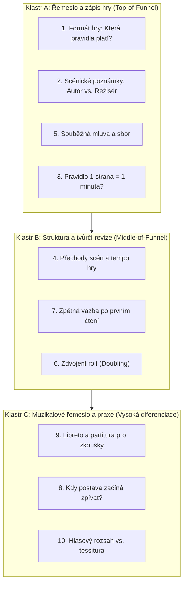

# Stagistic blog: research deseti úvodních témat

Datum: 13. října 2026. Jedná se o hloubkový redakční brief, obsahovou strategii a zadání pro budoucí tvorbu blogu Stagistic (nikoliv o implementaci kódu).

Pracovní předpoklad: Články budou psány anglicky (shodně s landing page); tento výzkumný a redakční dokument je v češtině. Primárním čtenářem je dramatik nebo autor muzikálu (od začínajících autorů hledajících řemeslnou jistotu po zkušené tvůrce v revizích). Sekundárním čtenářem jsou dramaturgové, režiséři a hudební korepetitoři.

---

## 1. Strategický rámec: Pozice a redakční filozofie

Blog Stagistic nesmí být generický „SEO content farm“ ani manuál k software. 

V souladu s vizí **The Dark Stage** a principem *„Theatrical without theatrics“* (viz [PRODUCT.md](file:///Users/milanzitka/git/stagistic/PRODUCT.md)):
1. **Dramaturgická a řemeslná autorita na prvním místě:** Článek řeší reálné dilema z praxe, dává slovo oběma stranám sporu a nabízí rozhodovací rámec.
2. **Přirozená, nenásilná konverze (Product-Led Content):** Stagistic se neobjevuje jako spasitel v prvním odstavci. Přichází až v závěru (posledních 100–150 slov) jako přirozené technické prodloužení principu, který článek rozebral.
3. **Konkrétní ukázky namísto abstrakce:** Každý článek obsahuje konkrétní ukázku z rukopisu (např. ukázku špatně vs. dobře vyřešeného formátu či přechodu).

---

## 2. Obsahové klastry a publikační vlny

Témata netvoří izolované ostrovy, ale tři provázané obsahové klastry rozdělené do 3 fází:

### Publikační harmonogram a fázování:
- **Vlna 1 (Základní autorita & nejvyšší hledanost):** **Téma 1** (Formát), **Téma 2** (Scénické poznámky), **Téma 9** (Libreto & partitura). Zahrnuje dvě nejčastější bolesti dramatiků a vlajkovou loď Stagisticu (integrovaný export muzikálu).
- **Vlna 2 (Řemeslná specifika & tempo):** **Téma 5** (Souběh hlasů), **Téma 4** (Přechody scén), **Téma 8** (Zpěv vs. mluva).
- **Vlna 3 (Inscenační realita & revize):** **Téma 6** (Doubling rolí), **Téma 7** (Table read feedback), **Téma 3** (Délka a pacing), **Téma 10** (Vokální nároky rolí).

---

## 3. Detailní zadání deseti článků

Každé zadání obsahuje čtenářský trigger (hook), komunitní hlasy, dramaturgické jádro, konkrétní strukturu článku, interní prolinkování a produktové napojení.

---

### Článek 1: Formát divadelní hry: Která pravidla skutečně potřebujeme?

- **Pracovní anglický titul:** *Stage Play Formatting: Which Rules Actually Matter (and Which Are Screenplay Myths)?*
- **Klastr & Cílovka:** Klastr A (Řemeslo). Vhodné pro autory přecházející od filmu/prózy a začínající dramatiky.
- **Hook (Otevírací situace):** Autor dokončí text ve Final Draftu nebo Wordu, pošle ho do divadelní soutěže a dostane odmítnutí s poznámkou „nesplňuje divadelní standard“. Proč filmový standard v divadle selhává?
- **Komunitní hlasy a spory:** 
  - Rozpor mezi rigiditou filmového formátu (kde se trestá každá odchylka) a divadelní tradicí, která má několik souběžných standardů.
  - Vlákna: [Really struggling with formatting](https://www.reddit.com/r/playwriting/comments/1rj8xlb/really_struggling_with_formatting/), [Current preferred way to format stage directions?](https://www.reddit.com/r/playwriting/comments/1b2oct7/), [Writing software discussion](https://www.reddit.com/r/playwriting/comments/1w1wcvi/writing_software/).
- **Dramaturgický a historický kontext:** 
  - Porovnání *Dramatists Guild Standard* (US: jména uprostřed, dialog odsazený, poznámky odsazené) vs. *Modern/UK Play Format* (jména vlevo tučně, úspornější vertikální členění, viz London Playwrights Workshop).
  - Proč divadlo preferuje jiné formátování než Hollywood: divadelní skript slouží jako pracovní partitura pro režiséra, scénografa a herce, ne jako blueprint pro střih.
- **Struktura článku:**
  1. *The Hollywood Trap:* Proč filmový Courier 12pt a scénáristické odsazení v divadle působí nepatřičně.
  2. *The Big Three Standards:* Tradiční americký (DG), moderní britský/evropský a vydavatelský (Samuel French / Nick Hern Books styl).
  3. *Side-by-side ukázka:* Stejný dialog (3 repliky) vysázený v US DG formátu vs. UK moderním formátu.
  4. *What literary managers actually care about:* Čitelnost, odlišení postav a prostor pro poznámky inscenátorů.
- **Návaznost na Stagistic:** Editor nabízí nativní divadelní bloky (Act, Scene, Cue, Dialogue, Stage Direction), automatické odsazení podle divadelních konvencí a čistý export do PDF bez nutnosti konfigurovat filmový software.
- **Klíčové dotazy (SEO):** `stage play format`, `playwriting format vs screenplay`, `dramatists guild script format`, `uk play format`.
- **Prolinkování:** Odkaz na Článek 2 (Scénické poznámky) a Článek 5 (Souběžná mluva).

---

### Článek 2: Scénické poznámky: Kde končí autor a začíná režisér?

- **Pracovní anglický titul:** *How Much Stage Direction Is Too Much? Finding the Line Between Intent and Micromanagement*
- **Klastr & Cílovka:** Klastr A (Řemeslo). Všichni autoři bojující s délkou a obsahem poznámek.
- **Hook (Otevírací situace):** Režisér na první čtené zkoušce vezme tužku a škrtne všechny autorské závorky jako `(hořce se pousměje, popojde tři kroky doprava k oknu)`. Cítíte se dotčeni – ale neměl náhodou pravdu?
- **Komunitní hlasy a spory:** 
  - Poptávka po pravidlech: Kolik řádků poznámky je únosných? Jak zapsat němou postavu, aniž by vznikl román?
  - Spory o „parentheticals“ (intonační návodky hercům) a blokování scény autorem.
  - Vlákna: [Stage Directions Question](https://www.reddit.com/r/playwriting/comments/1r2iw73/stage_directions_question/), [How much is too much with regards to directions?](https://www.reddit.com/r/playwriting/comments/1c71ynl/how_much_is_too_much_with_regards_to_directions/).
- **Dramaturgický a historický kontext:** 
  - Historický oblouk: Od Shakespearova strohého `Enter / Exit / Dies` po Shawovy a O'Neillovy mnohastránkové novely v poznámkách.
  - Zlaté pravidlo současné dramaturgie: *Is it essential dramatic action, or is it rehearsal choreography?* Pokud akce mění význam situace nebo nese informaci nepřítomnou v dialogu, musí v textu zůstat. Pokud předepisuje emoci či krok, patří herci.
- **Struktura článku:**
  1. *The Three Sins of Stage Direction:* Režírování herce z křesla, literární beletrizace a architektonický diktát scénografovi.
  2. *The Litmus Test:* Test vymazáním – změní se dramatická situace, když poznámku smažete?
  3. *Tři verze téže scény:* Přetížená (plná intonací) vs. podvyživená (nejasný kontext) vs. dramaticky funkční (úsporná, jasná v akci).
  4. *Jak zacházet s postavami beze slov:* Techniky popisu fyzického divadla a ticha.
- **Návaznost na Stagistic:** Rozlišení samostatných scénických poznámek (Block Stage Direction) a vložených návodek (Parenthetical / inline), včetně inteligentního tagování postav přímo v poznámkách bez deformace toku textu.
- **Klíčové dotazy (SEO):** `how much stage direction is too much`, `writing stage directions for theatre`, `parentheticals playwriting`.
- **Prolinkování:** Odkaz na Článek 1 (Formát) a Článek 4 (Přechody scén).

---

### Článek 3: Jedna stránka = jedna minuta? Limity filmového pravidla v divadle

- **Pracovní anglický titul:** *The One-Page-Per-Minute Myth: How to Actually Gauge Running Time in Theatre*
- **Klastr & Cílovka:** Klastr A / B. Autoři připravující text do soutěží s časovým limitem (např. festival 10-minute plays, 90minutový jednoakt).
- **Hook (Otevírací situace):** Napsali jste 10 stránek a myslíte si, že máte desetiminutovku. Na čtené zkoušce trvá 17 minut. Nebo naopak: 60stránková hra skončí za 40 minut. Kde udělalo filmové pravidlo chybu?
- **Komunitní hlasy a spory:** 
  - Neustálé dotazy: Kolik slov má mít jednoaktovka? Jak se počítají pauzy a scénický pohyb?
  - Vlákna: [Timing and length](https://www.reddit.com/r/playwriting/comments/1cepp3b/timing_and_length/), [Quick question on timing with pauses](https://www.reddit.com/r/playwriting/comments/1uf1u8w/quick_question/).
- **Dramaturgický kontext:**
  - Rozdíl mezi hustotou filmového scénáře a divadelní sazby (divadelní formáty mají větší řádkování a širší okraje pro poznámky).
  - Vliv stylu: Harold Pinter (stránka s tichem a pohledy trvá 3 minuty) vs. David Mamet / Aaron Sorkin (stránka staccato dialogu trvá 35 sekund).
  - Fyzické akce, přestavby, hudba a reakce publika (smích u komedie prodlouží hru o 10–15 %).
- **Struktura článku:**
  1. *Why the Screenplay Rule Fails on Stage:* Rozdíly v sazbě, rytmu a vizuálním médiu.
  2. *The Variables of Theatrical Time:* Pomalé ticho, rychlé střídání replik, fyzická komika a hudební vstupy.
  3. *Practical Formula:* Počítání slov (orientační průměr 130–160 slov za minutu při mluveném slovu) vs. časování čtením.
  4. *The Stopwatch Read:* Jak správně provést stopované čtení s přáteli či herci.
- **Návaznost na Stagistic:** Přehledná struktura scén a aktů v bočním panelu a čistý PDF export usnadňují přípravu měřeného čtení a orientaci v délce jednotlivých obrazů.
- **Klíčové dotazy (SEO):** `one page per minute playwriting`, `how long is a 10 minute play`, `word count for stage play`, `calculating play running time`.
- **Prolinkování:** Odkaz na Článek 7 (Table read) a Článek 4 (Přechody scén).

---

### Článek 4: Když krátké scény rozbíjejí tempo: Přechod jako součást hry

- **Pracovní anglický titul:** *Scene Transitions in Theatre: Keeping Dramatic Momentum Alive*
- **Klastr & Cílovka:** Klastr B (Struktura). Autoři s filmovým viděním, kteří píší hry s 25 krátkými lokacemi.
- **Hook (Otevírací situace):** Pětadvacet scén, každá na dvě minuty, pokaždé jiné místo v bytě či městě. Výsledek na jevišti? Dvě minuty hraní, třicet sekund tmy a šramotu nábytku. Divák ztrácí napětí v každé pauze.
- **Komunitní hlasy a spory:** 
  - Začínající autoři často nevnímají fyzickou váhu přestavby na scéně a střídají prostředí jako ve střihové skladbě.
  - Vlákno: [Scenes Are Too Short & Transition Heavy](https://www.reddit.com/r/playwriting/comments/1tom7eu/scenes_are_too_short_transition_heavy/).
- **Dramaturgický a historický kontext:** 
  - Shakespearovská „otevřená scéna“ (prázdné jeviště, kde lokaci definuje jazyk postavy bez nutnosti přestaveb).
  - Přechod není technická pauza, ale dramatická jednotka: využití zvuku, světla, plynulého překrytí akcí (French scenes) a simultánního prostoru.
- **Struktura článku:**
  1. *The Blackout Syndrome:* Proč zatmívačka spolehlivě zabíjí dramatické napětí.
  2. *Consolidation Strategy:* Jak sloučit pět mikroscén do dvou silných, plnokrevných dramatických situací.
  3. *Writing the Transition:* Jak v textu předepsat plynulý přechod (zvukový most, světelný střih, choreografie přestavby).
  4. *Příklad před a po:* 3 filmově rozkouskované scény vs. jejich divadelní konsolidace do jednoho kontinuálního obrazu.
- **Návaznost na Stagistic:** Interaktivní osnova scén (Scene Outline) a možnost snadného přeuspořádání a slučování obrazů přímo v editoru umožňují testovat dramatické tempo a strukturu hry.
- **Klíčové dotazy (SEO):** `scene transitions in theatre`, `how many scenes in a play`, `too many scene changes playwriting`.
- **Prolinkování:** Odkaz na Článek 3 (Délka hry) a Článek 6 (Doubling postav).

---

### Článek 5: Mluví spolu, nebo přes sebe? Jak čitelně zapsat více hlasů

- **Pracovní anglický titul:** *Speaking Together vs. Talking Over Each Other: Formatting Simultaneous Dialogue*
- **Klastr & Cílovka:** Klastr A (Řemeslo). Autoři píšící rodinné hádky, sborové scény, rychlé překrývání řeči či ensemble dialogy.
- **Hook (Otevírací situace):** Píšete scénu vyhrocené rodinné večeře. Čtyři postavy křičí zároveň. Jak to zapsat tak, aby text zůstal pro herce a čtenáře čitelný a neproměnil se v nepřehlednou změť sloupců?
- **Komunitní hlasy a spory:** 
  - Nejednotnost v softwaru: jak udělat dva sloupce, jak použít lomítka, jak zapsat sborový unisono výkřik.
  - Vlákna: [Simultaneous dialogue formatting](https://www.reddit.com/r/playwriting/comments/1q3nzuj/simulteneous_dialogue_formatting/), [Diskuze na Literature & Latte fóru](https://forum.literatureandlatte.com/t/simultaneous-dialogue/45443).
- **Dramaturgický a technický kontext:** 
  - Rozlišení tří jevů:
    1. *Unisono / Společná replika:* Dvě či více postav říkají přesně totéž ve stejný okamžik.
    2. *Překrytí / Interruption:* Jedna postava skočí do řeči druhé (standardní značení lomítkem `/` nebo pomlčkou `--`).
    3. *Paralelní / Souběžná mluva:* Dvě nezávislé konverzace probíhající současně (např. Caryl Churchill v *Top Girls*, Dan LeFranc v *The Big Meal*).
- **Struktura článku:**
  1. *Clarifying the Intent:* Co se má skutečně na jevišti dít? (Unisono vs. Skákání do řeči vs. Dva proudy).
  2. *Standard Conventions:* Značení lomítek, odsazení a hranice čitelnosti pro herce při čtené zkoušce.
  3. *Typografické pasti:* Kdy dva sloupce pomáhají a kdy ničí layout na menších formátech a tabletech.
  4. *Praktická ukázka:* Zápis rodinného sporu třemi různými způsoby.
- **Návaznost na Stagistic:** Stagistic podporuje společné repliky pro více mluvčích (Multiple Speakers / Groups) a správnou typografickou hierarchii pro ensemble dialogy přímo v divadelním editoru.
- **Klíčové dotazy (SEO):** `simultaneous dialogue playwriting format`, `overlapping dialogue stage play`, `how to format multiple characters speaking`.
- **Prolinkování:** Odkaz na Článek 1 (Formát hry) a Článek 8 (Muzikálový dialog).

---

### Článek 6: Jeden herec, několik postav: Psaní hry s ohledem na doubling

- **Pracovní anglický titul:** *One Actor, Multiple Roles: The Art and Practicality of Theatrical Doubling*
- **Klastr & Cílovka:** Klastr B (Struktura & Produkce). Autoři, kteří chtějí zvýšit šanci na uvedení své hry v malých a nezávislých divadlech.
- **Hook (Otevírací situace):** Vaše hra má 14 postav. Malé divadlo má rozpočet na 4 herce. Pokud jste hru nenapsali s vědomím zdvojení rolí, nikdo ji neuvede. Pokud ano, můžete z toho udělat nejsilnější dramaturgický prvek večera.
- **Komunitní hlasy a spory:** 
  - Hledání profesionálního zápisu v *Cast of Characters* / *Casting Breakdown*.
  - Jak ohlídat, aby stejný herec nemusel být ve dvou scénách za sebou bez času na převlek.
  - Vlákno: [Casting breakdown and doubling roles](https://www.reddit.com/r/Theatre/comments/edn6v1/how_to_signify_in_a_charactercasting_breakdown/).
- **Dramaturgický a historický kontext:** 
  - Historie od alžbětinského divadla (kde 12 herců hrálo 30 rolí) po moderní inscenace (*Angels in America*, *Cloud 9*).
  - Významové zdvojení (Thematic doubling): Když tentýž herec hraje otce i soudce, vzniká metafora, kterou divák vnímá podvědomě.
  - Fyzická realita: „Quick changes“ vyžadují čas, repliky jiných postav a promyšlenou kostýmní koncepci.
- **Struktura článku:**
  1. *Economic Necessity vs. Artistic Choice:* Proč doubling otevírá dveře k produkci a jak z něj udělat přednost.
  2. *The Thematic Resonance:* Příklady, kdy zdvojení rolí dává hře hlubší filozofický či psychologický rozměr.
  3. *The Quick-Change Matrix:* Jak si vytvořit přehled postav a scén a vyhnout se kolizím obsazení.
  4. *Jak zapsat Doubling v seznamu postav:* Správná terminologie pro Dramatis Personae.
- **Návaznost na Stagistic:** Katalog postav (Character Catalogue), sledování výskytů postav napříč scénami a filtrovaný export podle rolí usnadňují kontrolu obsazení a plánování souboru.
- **Klíčové dotazy (SEO):** `doubling roles in theatre`, `how to format casting breakdown doubling`, `playwriting character doubling tips`.
- **Prolinkování:** Odkaz na Článek 4 (Přechody scén) a Článek 10 (Hlasový rozsah postav).

---

### Článek 7: První čtení hry: Jak získat zpětnou vazbu, podle které se dá revidovat

- **Pracovní anglický titul:** *Your First Table Read: How to Elicit Feedback You Can Actually Revise With*
- **Klastr & Cílovka:** Klastr B (Revize). Autoři po dokončení prvního draftu stojící před prvním čtením.
- **Hook (Otevírací situace):** Skončilo první čtení. Kamarádi a herci vám řeknou: „Bylo to skvělé, strašně se mi to líbilo... akorát ten konec mi nějak neseděl a druhá půlka se trochu vlekla.“ Jdete domů zmatení a nevíte, co máte vlastně přepsat.
- **Komunitní hlasy a spory:** 
  - Jak zvládnout nervozitu při čtení, jak klást otázky a jak filtrovat destruktivní nebo naopak falešně lichotivé komentáře.
  - Vlákna: [Table Read!](https://www.reddit.com/r/playwriting/comments/l830lw/), [Have a table reading tomorrow. Any advice?](https://www.reddit.com/r/playwriting/comments/1tewz4z/have_a_table_reading_for_the_play_i_wrote/).
- **Dramaturgický a metodický kontext:** 
  - *Critical Response Process (Liz Lerman):* 4stupňový model (Statements of Meaning, Artist as Questioner, Neutral Questions, Permissioned Opinions).
  - Rozdíl mezi diagnózou problému (divák říká, kde se ztratil) a předepisováním léku (divák vymýšlí svůj vlastní děj).
- **Struktura článku:**
  1. *The Trap of Open Discussion:* Proč obecné „Co si o tom myslíte?“ vede k chaosu.
  2. *Listening to the Actors vs. Listening to the Script:* Co sledovat během čtení (kde herci klopýtají o slova, kde dochází dech).
  3. *The Four Critical Questions:* Jak formulovat cílené dotazy zaměřené na srozumitelnost motivací a rytmus.
  4. *Turning Notes into Revision Tasks:* Jak vytřídit poznámky z papírků do konkrétního plánu přepisování.
- **Návaznost na Stagistic:** Možnost vkládat komentáře přímo ukotvené ke konkrétním replikám a blokům textu, jejich filtrování a označování jako vyřešené při revizi rukopisu.
- **Klíčové dotazy (SEO):** `table read feedback playwright`, `how to run a table read`, `playwriting workshop feedback questions`.
- **Prolinkování:** Odkaz na Článek 3 (Délka a pacing) a Článek 2 (Scénické poznámky).

---

### Článek 8: Kdy má postava začít zpívat? Přechod z mluveného slova do písně

- **Pracovní anglický titul:** *When Words Aren't Enough: Crafting the Transition from Dialogue to Song*
- **Klastr & Cílovka:** Klastr C (Muzikál). Libretisté, textaři a skladatelé řešící integraci libreta a hudby.
- **Hook (Otevírací situace):** Postavy vedou dialog, najednou začne hrát klavír a jedna z nich začne zpívat přesně to, co před deseti sekundami řekla mluveným slovem. Píseň působí nadbytečně a divák čeká, až skončí, aby mohl pokračovat příběh.
- **Komunitní hlasy a spory:** 
  - Hledání správného poměru mluveného textu a zpěvu; skladatelé řeší, jak zakomponovat repliky uvnitř písně a jak postavit plynulý nájezd (cue-to-song).
  - Vlákna: [Song pacing in musicals](https://www.reddit.com/r/musicalwriting/comments/1gx5j4u/), [Dialogue during songs?](https://www.reddit.com/r/musicalwriting/comments/f8d5hc/dialogue_during_songs/).
- **Dramaturgický a hudební kontext:** 
  - Klasická muzikálová poučka (Oscar Hammerstein, Lehman Engel): *When the emotion becomes too strong for speech, you sing; when it becomes too strong for song, you dance.*
  - Problém redundance: Píseň nesmí být pouhým zopakováním dialogu. Musí být dramatickým jednáním (Action Song), v němž dojde k rozhodnutí, posunu vztahu nebo odhalení.
  - Práce s *Musical Cue* a *Underscore:* Jak připravit divákovo i hercovo ucho na změnu vyjadřovacího módu.
- **Struktura článku:**
  1. *The Redundancy Pitfall:* Proč „zpívání pocitu“ nestačí a proč píseň musí posouvat děj stejně jako scéna.
  2. *The Launching Pad:* Jak vystavět dialog těsně před písní, aby hudební nástup působil nevyhnutelně.
  3. *Spoken Dialogue Inside Songs:* Jak zapsat mluvené vsuvky a přechody v rytmu hudby (vamp, underscore).
  4. *Case Study:* Rozbor scény – srovnání písně, která situaci zastavuje, s písní, která ji transformuje.
- **Návaznost na Stagistic:** Specializované bloky pro text písně (Lyrics) oddělené od běžného dialogu, správa hudebních čísel a vkládání hudebních značek přímo do textu libreta.
- **Klíčové dotazy (SEO):** `when should characters sing in a musical`, `writing a musical book and score`, `dialogue into song transition`, `musical theatre song placement`.
- **Prolinkování:** Odkaz na Článek 9 (Libreto a partitura) a Článek 5 (Více hlasů).

---

### Článek 9: Libreto a partitura pro zkoušky: Jak připravit jeden použitelný pracovní podklad

- **Pracovní anglický titul:** *Libretto and Score: How to Build a Rehearsal Document That Actually Works*
- **Klastr & Cílovka:** Klastr C (Muzikál & Produkce). Libretisté, skladatelé, režiséři a hudební korepetitoři.
- **Hook (Otevírací situace):** První hudební zkouška muzikálu. Herci mají libreto vytištěné z Wordu na jedné straně pultu a rozpadající se noty z Dorica či Sibelia na druhé. Nikdo neví, na které stránce not začíná píseň č. 4 a odkud se vlastně bere replika těsně před refrénem.
- **Komunitní hlasy a spory:** 
  - Neustálé dotazy v r/musicalwriting: Jak se má formátovat muzikálový skript? Patří noty přímo do textu? Jak se číslují stránky při změnách?
  - Vlákna: [What does a musical script format look like](https://www.reddit.com/r/musicalwriting/comments/igs4xf/), [Score format conventions](https://www.reddit.com/r/musicalwriting/comments/1jl8ncp/score_format_conventions/).
- **Dramaturgický a provozní kontext:** 
  - Rozdíl mezi materiály pro *Submission* (oddělené libreto a demo nahrávka pro producenta / soutěž) a materiály pro *Rehearsal* (integrovaný pracovní materiál pro zkušebnu).
  - Standardy New Musicals Inc. (NMI Format Guidelines): Vzájemné odkazování dialogových cues a taktových čísel (measure numbers) v partituře.
- **Struktura článku:**
  1. *Submission Copy vs. Rehearsal Copy:* Proč potřebujete dva různé výstupy pro dva různé účely.
  2. *The Anatomy of a Music Cue:* Jak správně zapsat náběh (Cue into music), číslování hudebních čísel a vnitřní dialogy.
  3. *The Pagination Nightmare:* Proč ruční vkládání stránek v PDF editoru končí chaosem při první škrtnuté scéně.
  4. *The Ideal Rehearsal Binder:* Jak má vypadat ideální pracovní podklad pro režiséra i korepetitora.
- **Návaznost na Stagistic:** **Vlajková funkce Stagisticu:** Možnost nahrát PDF partitury přímo k jednotlivým hudebním číslům a vygenerovat jediný integrovaný PDF export s průběžným číslováním stránek, kde text a noty plynule navazují.
- **Klíčové dotazy (SEO):** `musical script format with sheet music`, `integrated libretto and score`, `how to format a musical script`, `musical theatre rehearsal score`.
- **Prolinkování:** Odkaz na Článek 8 (Kdy postava zpívá) a Článek 10 (Hlasový rozsah).

---

### Článek 10: Hlasový rozsah role: Proč dva krajní tóny v obsazení nestačí

- **Pracovní anglický titul:** *Beyond High and Low Notes: Why Character Vocal Range Is Only Half the Story*
- **Klastr & Cílovka:** Klastr C (Muzikál & Casting). Autoři muzikálů, skladatelé a herci hledající role.
- **Hook (Otevírací situace):** V popisu postavy napíšete „Rozsah: A3 až C6 (Soprán)“. Na konkurz přijde klasická sopranistka a vy po ní chcete, aby ve výšce zpívala plným beltem. Výsledek? Zklamání na obou stranách a hlasová únava po třech opakováních.
- **Komunitní hlasy a spory:** 
  - Herci si stěžují na zavádějící castingové profily, které uvádějí pouze extrémní tóny, nikoliv to, kde role leží 80 % času.
  - Vlákna: [Audition breakdown listing vocal ranges incorrectly?](https://www.reddit.com/r/MusicalTheatre/comments/1vof86e/audition_breakdown_listing_vocal_ranges/), [May Week 2 – The Voice (r/musicalwriting)](https://www.reddit.com/r/musicalwriting/comments/ghmn8r/may_week_2_the_voice/).
- **Dramaturgický a hlasový kontext:** 
  - Rozdíl mezi *Range* (fyzický rozsah od nejnižšího po nejvyšší tón) a *Tessitura* (oblast, kde hlas pobývá nejčastěji a s jakou dynamikou/námahou).
  - Stylové požadavky: Legit soprano, Belt, Mix, Pop/Rock, Patter song. Dva stejné tóny v jiném pěveckém rejstříku vyžadují zcela jiný typ obsazení.
  - Odborné reference: David Sisco a Laura Josepher (*Writing for Today’s Musical Theatre Performer*), MTI Casting breakdowns.
- **Struktura článku:**
  1. *The Fallacy of the Extreme Note:* Proč jediný vysoký tón na konci finále nesmí definovat celý hlasový profil role.
  2. *Range vs. Tessitura vs. Style:* Tři dimenze popisu hlasových nároků divadelní role.
  3. *Writing the Breakdown for Musical Directors and Actors:* Jak správně formulovat vokální profil v přehledu postav (např. *Mezzo with strong belt to D5, comfortable in conversational chest mix*).
  4. *Checklist pro autory:* Jak otestovat vokální nároky vlastních písní ještě před odesláním textu na casting.
- **Návaznost na Stagistic:** Zadávání hlasových typů a rozsahů přímo u postav v katalogu rolí a jejich automatické zahrnutí do přehledových stránek a exportovaných charakteristik.
- **Klíčové dotazy (SEO):** `vocal range vs tessitura musical theatre`, `character vocal range casting breakdown`, `writing musical theatre vocal ranges`.
- **Prolinkování:** Odkaz na Článek 6 (Doubling postav) a Článek 9 (Libreto a partitura).

---

## 4. Redakční standard článku (Editorial Guidelines)

Pro zajištění konzistence napříč všemi 10 články stanovujeme jednotný formát a styl:

1. **Délka:** **1 000–1 400 slov.** Dostatečná hloubka pro vyřešení problému, žádná zbytečná výplňová vata.
2. **Tón komunikace:** Profesionální, věcný, empatický k tvůrčímu procesu, bez marketingových klišé a bez prázdného nadšení. Jazyk divadelního profesionála mluvícího s kolegou.
3. **Stavba článku:**
   - **Hook & The Dilemma (150 slov):** Reálná situace ze zkoušky, čtení nebo psacího stolu.
   - **The Anatomy of the Problem (250–350 slov):** Proč problém vzniká, historický či dramaturgický kontext.
   - **Actionable Framework / Solutions (400–500 slov):** Konkrétní postupy, 2–3 cesty k řešení s jejich výhodami a riziky.
   - **Real Example / Script Excerpt (150–200 slov):** Ukázka z textu (před a po, špatně vs. správně).
   - **The Tool / Stagistic Context (100–150 slov):** Jak tento princip zohledňuje Stagistic bez nátlaku („Jak vám s tím může pomoci editor“).

---

## 5. Technické předpoklady pro implementaci na webu

- **Obsahový formát:** Statické soubory `.md` s bohatým YAML frontmatterem (title, description, author, publishDate, tags, cluster, relatedPosts) uložené v repozitáři.
- **Astro kompatibilita:** Landing page v `apps/landing` je postavena na frameworku Astro. Čistý Markdown `.md` je v Astru nativně podporován bez nutnosti dalších knihoven.
- **Budoucí rozšíření o MDX:** V případě potřeby interaktivních komponent (např. interaktivní porovnávač formátů textu nebo přepínač US vs. UK notace) lze integrovat `@astrojs/mdx`. Pro startovní sérii 10 článků plně postačuje standardní Markdown se statickými SVG/CSS ukázkami.

